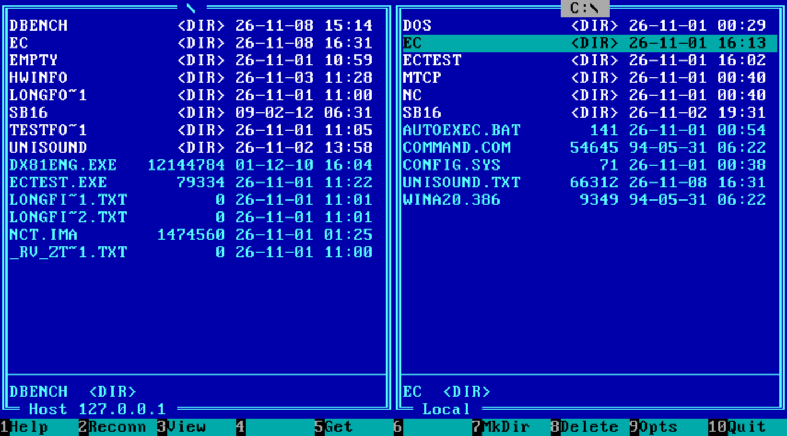
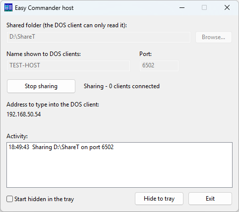

# Easy Commander

A Norton Commander style file manager for **MS-DOS** that fetches files over the
network from a modern PC. A small **host program** (Windows / Linux) shares a
folder read-only; the **DOS client** shows the host on the left and a local DOS
folder on the right, and downloads files and whole folders with F5.

It exists because getting files onto a retro PC over Ethernet usually means
setting up FTP, SMB1 or serial transfers, which are all awkward. Here the host
is a single executable and the client is a two-panel program you already know
how to use.

*Easy Commander in 86Box: the host's folder on the left, the local DOS folder on the right.*

## Status

Version 1.0. Tested in an emulated PC (86Box, MS-DOS 6.22, NE2000
compatible network card) and on two real machines, both with a CompactFlash card
instead of a hard disk and an RTL8019AS ISA network card with the Realtek packet
driver: an AMD 5x86-133 with 8 MB RAM, and a Cyrix 486DLC with 4 MB RAM (with an
8 bit XT-IDE card and with a 16 bit IDE controller). Downloads, CRC32 checks,
host search and switching between two hosts worked on all of them.
**Older CPUs (286 and below) have not been tested yet.**

* Browse the host's folders, select with Insert, download files and folders
  with their subfolders, keeping the structure.
* Optional CRC32 check of every downloaded file (read back from disk). A faster
  CRC32 loop for slow CPUs is on by default (same result; F9 switches it off).
* View a file with F3, on the host or on the local disk: text or hex (F4), search
  (F7; in hex mode type hex bytes such as `6E 50`, or a text in double quotes),
  scrolling with the cursor keys. A file on the host is read in pieces,
  so only what you look at is transferred.
* Downloaded files keep the date and time they have on the host (folders get
  the current date).
* Select and unselect files by a mask (`+` and `-`, for example `*.TXT`).
* Cancel a download with Esc; existing files are never overwritten without asking.
* **Download only, by design:** the host shares a folder read-only and the client
  has no upload. Nothing on the host can be changed, renamed or deleted from the
  DOS side, and the host only accepts connections from local network addresses.
* Delete files and folders on the *local* side (F8).
* Switch drives (Alt+F2) and host (Alt+F1).
* Remembers the last host and the CRC option in `EC.INI` next to `EC.EXE`; started
  without arguments, `EC` connects to the saved host.
* Finds hosts on the local network by itself (UDP broadcast): at the first start
  without arguments, and with Alt+F1 at any time; several hosts are shown in a list.

## Quick start

You need two computers on the same local network (Ethernet, or Wi-Fi on the
modern side):

* the **host**: a modern PC with Windows 10 or newer (or Linux) that has the
  files you want to copy;
* the **DOS PC**: MS-DOS with a network card, its **packet driver**, and an
  **mTCP configuration** (Easy Commander uses the mTCP TCP/IP stack, so the
  network setup is the same as for any other mTCP program).

**1. Download.** Get `EC.EXE` (the DOS client) and `echost.exe` (the Windows
host) from the [latest release](https://github.com/HunOmegared/Easy-Commander/releases/latest).
On Linux build the host from source (`cd host && go build -o echost`, see
[docs/BUILDING.md](docs/BUILDING.md)).

**2. Start the host** on the modern PC: run `echost.exe`. Windows asks once
whether the firewall may allow it: allow it on private networks. It opens a
small window; choose the folder to share with *Browse...* (sharing starts at
once) and note the address it shows, for example `192.168.1.10`.

The window can be closed: the host keeps running in the notification area
(tray); a right click on its icon has Open, Start/Stop and Exit. The settings
are kept in `echost.ini` next to the program. `echost.exe -console` runs it
without a window, and on Linux it always runs in the console:

    echost /path/to/shared/folder

The host listens on TCP port 6502 (and UDP 6502 for host searches). Only
connections from private (local network) addresses are accepted, and it can
only read: nothing can be written to the shared folder from the DOS side.

**3. Get the client onto the DOS PC.** Copy `EC.EXE` there once, in any way you
like (floppy, CompactFlash card in a reader, serial cable ...).

**4. Bring up the network on the DOS PC** as for any mTCP program: load the
packet driver of your card, tell mTCP where its configuration is, and (if you
do not use fixed addresses) run `DHCP`. For example, with a packet driver on
interrupt 0x60 (the driver's name and parameters depend on your card; see its
documentation and the mTCP documentation):

    <your packet driver> 0x60
    SET MTCPCFG=C:\MTCP\MTCP.CFG
    DHCP

A `MTCP.CFG` for fixed addresses looks like this:

    PACKETINT 0x60
    IPADDR 192.168.1.50
    NETMASK 255.255.255.0
    GATEWAY 192.168.1.1

**5. Start Easy Commander:**

    EC

The first time, it looks for hosts on the network by itself and connects to the
one it finds (or shows a list when there are several). It remembers the host in
`EC.INI`. To use a given host: `EC 192.168.1.10` (or `EC host-name [port]`).

The host's folder is the left panel, the current folder of the DOS PC the right
one. Move with the cursor keys, **Tab** switches panels, **Enter** opens a
folder, **Insert** (or `+` with a mask such as `*.TXT`) selects files, **F5**
downloads the selected files and folders to the folder in the right panel,
**F3** looks into a file (a driver's README, say), **F10** quits. All keys are
in the table below.

If something does not work:

* *No host found / could not connect:* the two computers must be in the same
  network (the search is a broadcast and does not cross routers). Type the
  host's address: `EC 192.168.1.10`. Check that the host window says "Sharing"
  and that the firewall allows it.
* *Complaints about the configuration or the packet driver at start:* the
  network is not set up yet (try `PING` from the mTCP package first).
* *Slow:* see [Performance](#performance); on old machines the disk, not the
  network, is the limit.

## Keys

| Key | Action |
|---|---|
| Up, Down, PgUp, PgDn, Home, End | move the cursor |
| Enter | open a folder (`..` goes up) |
| Tab | switch panel |
| Insert | select / unselect, move down |
| `+` `-` | select / unselect files by a mask such as `*.TXT` or `READ*` (Enter alone = `*.*`, all) |
| `*` | invert the selection |
| F3 | view the file under the cursor (in the viewer: F4 hex/text, F7 search, Left/Right sideways, Esc or F10 close) |
| F5 | download the selected items (or the one under the cursor) to the right panel's folder |
| F7 | make a folder (right panel) |
| F8 | delete (right panel only; only `Y` confirms) |
| F9 | options (CRC32 check of every download, fast CRC32 code) |
| F2 | reconnect and refresh the host panel |
| Alt+F1 | connect to another host |
| Alt+F2 | change drive (right panel) |
| Ctrl+O | look at the DOS screen (the start text and earlier commands); any key returns |
| F10, Esc | quit |

## Repository layout

| Folder | Content |
|---|---|
| `host/` | the host program (Go) and its tests |
| `client/ec/` | the DOS client (`EC.CPP`, `MAKEFILE`, `EC.CFG`), built inside the mTCP source tree |
| `client/ectest/` | a small command line test client (HELLO, LIST, TREE, GET, GETDIR, CRC) |
| `client/ecui/` | the user interface prototype (builds without mTCP, no network) |
| `docs/` | [protocol](docs/PROTOCOL.md) and [build instructions](docs/BUILDING.md) |
| `tests/logic/` | logic tests that run without DOS, see its README |

## Performance

Measured on real machines, always downloading the same 12 MB file. All of them
use a CompactFlash card instead of a hard disk, an RTL8019AS ISA card (10 Mbit/s)
and the Realtek packet driver. The first test series, on the AMD 5x86-133 (8 MB
RAM, CF card from InnoDisk):

| Test | Speed |
|---|---|
| network only (`ectest ... GET file NUL`) | about 600 KB/s |
| network + disk (`ectest ... GET file C:\file`) | about 387 KB/s |
| Easy Commander, F5 | about 361 KB/s |

The speed is even over the whole file. Receiving and writing to the disk do
not overlap, so their times add up; the disk side is the slower part on this
machine. The test client's `/T` switch prints the speed of every megabyte.

The same file with Easy Commander (F5), on the 5x86-133 and a Cyrix 486DLC (4 MB RAM):

| Machine and disk | CRC32 check off | CRC32 check on |
|---|---|---|
| AMD 5x86-133, CF (InnoDisk) | 361 KB/s | 212 KB/s |
| AMD 5x86-133, CF (SiliconSystems) | 394 KB/s | - |
| Cyrix 486DLC, 8 bit XT-IDE card, CF | 105 KB/s | 51 KB/s |
| Cyrix 486DLC, 16 bit IDE, CF | 425 KB/s | 225 KB/s (126 KB/s with the old CRC loop) |

On the slow machines the disk is what limits the speed (a 486DLC with an 8 bit
XT-IDE card writes only about 130 KB/s; its network-only speed is 651 KB/s), and
the CRC32 check, which reads the file back, takes about as long as the
download itself unless the fast CRC32 loop (F9) is used.

## Known issues

* Build with **Open Watcom 1.9**. With the Open Watcom 2.0 beta (the V2
  GitHub fork, October 2026 build) the program prints `End: heap is
  corrupted!` at exit. The message comes from mTCP's `UTILS.CPP`
  (`_heapchk()` after the stack is shut down); the unmodified mTCP Netcat
  prints it too with that compiler, and it disappears when EC and ECTEST are
  built with Open Watcom 1.9. Every CRC32 check passed with both compilers.
* The client only sees DOS 8.3 names; the host maps long names to
  `BASE~1.EXT` style names.
* The host search is a broadcast: it does not cross routers, and hosts started
  with another `-port` are not found by it (type their address instead). In the
  86Box "SLIRP" network mode the host is found but listed as 127.0.0.1; type
  10.0.2.2 instead.
* Memory use: while the program runs, F1 shows the free conventional memory;
  compare it with the value `MEM` reports before starting `EC`. An earlier build
  used about 286 KB; later builds use roughly 16 KB more (bigger write buffer).

## Roadmap

* Test on more hardware (other network cards and packet drivers, 286 and 386 machines, less RAM).

## License

GPL-3.0-or-later. The DOS client links the mTCP library by Michael B. Brutman
(GPLv3) and its structure follows mTCP Netcat, so the DOS programs must be GPLv3.
To keep things simple the whole project uses the same license. The mTCP source
is **not** part of this repository; get it from <http://www.brutman.com/mTCP/>.

Copyright (C) 2026 Daniel Szentmiklosi.
